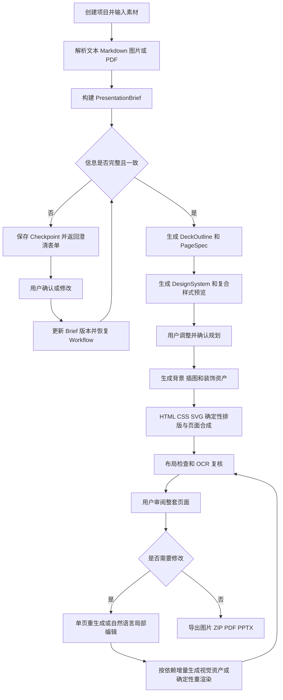
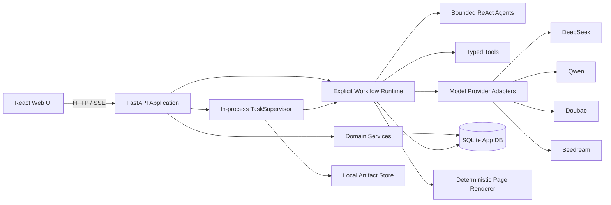
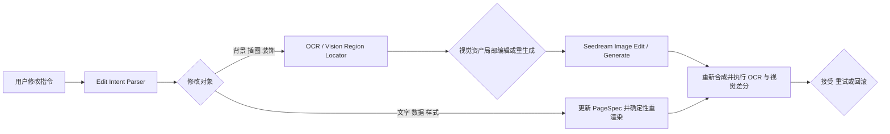

# PPT Agent

一个面向个人用户、可在本地运行的开源 PPT 生成 Agent。

用户可以输入文本、Markdown、参考图片或 PDF。系统通过可恢复的 Agent Workflow 完成需求澄清、整套演示文稿规划、视觉风格设计、生成式视觉资产、确定性文字排版、页面合成、质量检查和自然语言局部修改，最终导出逐页图片、ZIP、PDF，以及每页铺满图片的 PPTX。

本项目不是一次性的能力演示。设计目标是构建一个关注生成效果、成本、稳定性、可观测性和可恢复性的生产级本地应用。

> 当前后端已完整支持可恢复规划、素材解析、DeepSeek/Seedream/Qwen 云调用、确定性排版、视觉/OCR 质检、自然语言单页编辑，以及 PNG/JPG/ZIP/PDF/图片型 PPTX 导出；无 Key 的确定性模式可运行完整闭环。React 前端将在下一阶段实现。进度检查点以 [AGENTS.md](AGENTS.md) 为准。

快速上手：[本机与 Docker 启动](docs/quickstart.md) · [配置参考](docs/configuration.md) · [云 Provider](docs/provider-setup.md) · [HTTP API 教程](docs/api-tutorial.md)

## 1. 产品定位

### 1.1 目标用户

- 面向个人用户的 To C 开源项目。
- 用户下载项目后在本机启动，通过本地网页使用。
- 用户自行配置模型服务的 API Key。
- 默认不依赖云端控制面，不要求用户部署 Redis、PostgreSQL 或第三方观测平台。

### 1.2 核心价值

项目不只负责“调用模型生成几张图片”，而是提供完整的 PPT 创作闭环：

1. 理解用户输入和参考素材。
2. 在信息缺失或冲突时暂停 Workflow，向用户展示结构化表单。
3. 生成整套 PPT 的叙事结构、逐页内容、布局描述和设计系统。
4. 先生成一张复合样式预览图供用户确认。
5. 允许用户在昂贵的图片生成操作前修改规划结果。
6. 用户确认后生成背景、插图和装饰，通过 HTML/CSS/SVG 确定性排版文字与数据，并合成为逐页图片。
7. 支持单页重生成和基于自然语言的局部编辑。
8. 导出图片、ZIP、PDF 和图片型 PPTX。

### 1.3 首版不解决的问题

- 不提供 PowerPoint 元素级编辑能力。
- 不让生图模型承担标题、正文、数字、引用、页码和表格文字的最终排版；少文字的 `full_raster` 模式属于用户明确选择的例外。
- 不在首版提供画布框选、涂抹、图层和文本框编辑。
- 不在首版建设云端多租户、团队协作、计费和账号体系。
- 不在首版构建完整离线评测平台。

## 2. 产品原则

1. **结构化规划先于生成**：先确认 Brief、设计系统、逐页方案和文字布局，再触发高成本图片生成。
2. **Workflow 控制流程，Agent 处理不确定性**：确定性状态机负责顺序、预算、审批和恢复；ReAct Agent 只在需要探索和判断的节点运行。
3. **结构化状态是事实源**：聊天用于交互，不能代替项目状态、页面规格或用户确认记录。
4. **默认成本可控**：任何自动重试、修复和升级模型都有上限。
5. **所有重要操作可追溯、可恢复、可撤销**。
6. **部署简单但代码边界严格**：首版采用单进程模块化单体和进程内任务调度，不提前引入分布式设施。
7. **Provider 可替换**：业务代码按能力调用模型，不直接依赖厂商模型名称。
8. **本地优先与隐私透明**：明确展示哪些素材会发送给哪个模型服务。
9. **文字确定性优先**：生成模型负责视觉创意，Renderer 负责可交付的文字、数字和数据排版。

## 3. 端到端用户流程



默认页数为 8 页。页数是 `PresentationBrief` 的核心字段之一，Agent 可以根据素材量、演讲时长和目标场景提出建议：

- 常见范围：5–20 页。
- 建议上限：30 页。
- 硬上限：50 页。

页数调整会同步展示预计成本和生成时间。用户确认大纲后仍可增页、删页和调整顺序，只重新规划受影响部分。

## 4. 系统架构

项目采用 Python 单进程模块化单体和 React 前端。FastAPI 进程内的轻量 `TaskSupervisor` 负责后台任务和页面并发，SQLite 保存可恢复状态：



部署上保持单进程，代码中按领域拆分。首版不引入独立 Worker、持久化任务队列、任务租约和 heartbeat，也不要求 PostgreSQL。浏览器关闭不会影响进程内任务；应用重启后根据 SQLite 中的 Run、Step、Provider Operation、Provider Attempt 和 Artifact 状态执行恢复扫描与远端对账，不统一重放未完成请求。

## 5. Agent 与 Workflow 设计

### 5.1 混合编排

顶层使用项目自有的显式、可持久化 Workflow Runtime，不依赖第三方 Agent 编排框架。它负责：

- 阶段顺序和状态转换。
- 人工确认和意图澄清。
- 预算检查和调用授权。
- 超时、重试、取消和恢复。
- Artifact 版本和依赖失效。

ReAct Agent 只用于存在明显不确定性的任务，例如：

- 分析用户目标和输入素材。
- 生成真正有必要的澄清问题。
- 规划叙事与页面创意。
- 判断自然语言修改目标。
- 在 OCR 存在多个候选时定位区域。

每个 Agent 只能访问任务所需的工具白名单，并受到最大步骤、最大调用次数、超时和成本预算约束。

Workflow 由版本化定义、步骤处理器和显式转换规则组成。步骤统一返回 `Completed`、`Interrupted`、`RetryScheduled`、`Failed` 或 `Cancelled`。SQLite 是运行状态的唯一事实源；异步生成器只负责执行期间的事件投影和 SSE 推送，不承担持久化或恢复职责。

### 5.2 核心结构化对象

- `PresentationBrief`：用途、受众、语言、主题、语气、页数、比例、预算和质量策略。
- `DesignSystem`：配色、字体、视觉风格、图片风格、间距、页面类型和禁用项。
- `DeckOutline`：整套叙事顺序、章节及每页目标。
- `PageSpec`：渲染模式、画布与安全区、结构化文本框、字体回退、最小字号、溢出策略、视觉区域、提示词和验收条件。
- `ExecutionRun`：一次规划、生成、编辑或导出任务的执行记录。
- `ArtifactVersion`：规划、参考图、页面图片和导出文件的不可变版本。
- `EditIntent`：修改目标、定位线索、预期变化、禁止变化和执行策略。
- `QualityReport`：质量问题、严重等级、区域、证据和建议动作。

所有模型输出必须先通过 Schema 校验。自由文本不能直接驱动文件写入、任务状态或昂贵操作。

### 5.3 运行时持久化

轻量 Workflow Runtime 使用同一个 SQLite 数据库维护以下逻辑表：

- `workflow_runs`：当前状态、当前步骤、Workflow 版本、Brief 版本、预算和最终结果。
- `workflow_steps`：步骤输入输出引用、状态、尝试次数、标准化错误和幂等键。
- `pages`：页面状态、当前处理阶段和当前 PageSpec 版本。
- `workflow_interrupts`：表单 Schema、恢复标识、等待状态和用户提交值。
- `workflow_events`：只追加的轨迹事件，用于审计、SSE 和前端可视化。
- `provider_operations`：稳定的业务意图和由 Attempt 推导的汇总状态。
- `provider_attempts`：每次实际远端提交、远端任务 ID、状态、费用和错误。
- `cost_reservations`：每个 Attempt 的原子预算预留与结算状态。
- `artifacts`：文件哈希、版本、来源、依赖和相对路径。

状态变化、Interrupt 创建和相关事件写入需要在同一个数据库事务中完成。Workspace 保存图片等大文件，JSONL 只作为可选的诊断导出，不作为运行状态来源。

### 5.4 意图澄清工具

意图澄清承担人机交互流程的中断与恢复，而不是简单生成一句追问：

```text
Workflow 节点运行
  → Agent 调用 request_clarification
  → 持久化完整 Checkpoint
  → Run 进入 WAITING_FOR_USER
  → Web UI 渲染结构化表单
  → 用户确认或修改
  → 校验 Resume Payload
  → 生成新的 PresentationBriefVersion
  → 恢复原 Workflow
```

概念接口：

```python
request_clarification(
    schema_path: str,
    question: str,
    reason: str,
    input_type: Literal["single_select", "multi_select", "text", "number"],
    options: list[Option],
    recommended_value: Any,
    required: bool,
) -> WorkflowInterrupt
```

Checkpoint 至少记录 Workflow、Run、节点、恢复位置、Brief 版本、表单 Schema、已完成输出引用、提示词与 Skill 版本、已发生成本和剩余预算。恢复的是持久化状态和明确的步骤边界，而不是 Python 调用栈或框架内部执行对象。

同一套 Interrupt/Resume 协议也用于大纲确认、样式预览确认、预算超限、低置信度定位、结果选择和 Provider 配置缺失。

### 5.5 自然语言局部编辑

首版不提供人工画布选区。局部编辑先区分确定性内容层与生成式视觉层：



例如“把标题变小”：

1. 根据 PageSpec 中稳定的文本块 ID 定位标题。
2. 更新字号或布局约束，不调用 Seedream。
3. 通过固定 Chromium、字体集合和 viewport 重新渲染。
4. 检查安全区、最小字号、溢出和文字完整性。
5. 保存编辑前后版本，允许用户比较和回滚。

“把右侧人物换成女性”等请求才进入视觉定位和 Seedream 编辑。跨层修改会按 Artifact 依赖规则使受影响的视觉资产与最终页面变为 stale，再重新规划和合成。

默认渲染协议见 [混合栅格渲染协议](docs/specs/01-hybrid-rendering.md)。

## 6. 上下文管理

系统不把所有历史对话拼成不断增长的 Prompt，而是维护五层上下文：

1. `User Turn Context`：当前用户输入和当前动作，用完即释放。
2. `Page Context`：当前页 PageSpec、图片、OCR、修改摘要和相邻页面摘要。
3. `Deck Context`：大纲、叙事目标、顺序、术语和跨页一致性约束。
4. `Design Context`：DesignSystem、复合参考图、提示词模板和视觉禁用项。
5. `Source Context`：原始素材分块、图片描述和可追溯引用。

`Context Compiler` 根据任务类型组装最小充分上下文。例如修改第 5 页时，只加载第 5 页、必要的相邻页摘要、设计规范和相关素材片段，不注入整套原图与完整聊天历史。

上下文管理需要满足：

- 结构化状态与聊天历史分离。
- 长对话按主题和决策压缩，原始记录仍可追溯。
- PageSpec 内容可以追溯到输入素材。
- 每次调用记录上下文来源、Token 分布和裁剪原因。
- 缓存键包含模型版本、提示词版本、输入哈希和配置。
- 用户修改产生新版本，不覆盖原版本。

“可解释的上下文编译”是项目的核心亮点之一：用户或开发者可以看到模型为何获得这些信息，以及哪些内容因预算或相关性被排除。

## 7. 模型适配层

模型层按能力抽象，而不是按厂商硬编码：

```text
Model Gateway
  ├── TextReasoningProvider
  ├── StructuredOutputProvider
  ├── VisionUnderstandingProvider
  ├── ImageGenerationProvider
  ├── ImageEditingProvider
  ├── EmbeddingProvider
  └── OCRProvider
```

首版 Provider：

| 能力 | 默认实现 | 说明 |
|---|---|---|
| 文本推理与规划 | DeepSeek | OpenAI 兼容文本接口 |
| 视觉理解与区域定位 | Qwen 云端 API | 默认视觉 Provider |
| 视觉理解备选 | 豆包多模态 API | 用户可配置为默认或备用 |
| 图片生成与编辑 | Seedream | 支持参考图和图像编辑 |
| OCR | PaddleOCR | 本地执行，承担文字识别与定位 |

模型 ID、Base URL、超时、价格和能力由配置注册表管理。业务代码只请求 `text.reasoning`、`vision.locate`、`image.generate` 或 `image.edit` 等能力。

每个模型版本还必须声明 `ProviderCapabilities`，包括同步/异步模式、幂等键、查询与取消支持、输入数量和格式上限、Mask/线框/涂鸦语义、内容安全错误、结构化输出子集、计价单位、地域和数据保留策略。Workflow 先协商能力，再选择提交、降级或中断路径，不能假设同一 Protocol 的所有实现具有相同语义。

所有可能计费的远端调用使用稳定的 `operation_id`、逐次 `attempt_id` 和显式远端状态机。详细定义见 [Provider 能力与远端调用恢复协议](docs/specs/03-provider-operations.md)。

首版不默认自动跨供应商回退，避免要求用户配置多套 Key。只有用户同时配置多个 Provider 并主动开启后，才允许执行 fallback。

参考资料：

- [Qwen 图像与视频理解](https://help.aliyun.com/zh/model-studio/vision)
- [Qwen 结构化输出](https://docs.modelstudio.console.alibabacloud.com/en/model-studio/qwen-structured-output)
- [Seedream 4.0–5.0 提示词指南](https://www.volcengine.com/docs/82379/1829186)

## 8. 工具与 Skill

### 8.1 工具分类

- 素材工具：PDF/Markdown 解析、图片元数据、OCR、内容检索。
- 交互工具：意图澄清、人工审批、预算确认和结果选择。
- 规划工具：Schema 校验、页数与成本估算、引用核对和上下文检索。
- 图像工具：缩放、裁切、拼图、差分、区域检测、遮罩生成和 Seedream 调用。
- 渲染工具：受限 HTML/CSS/SVG 模板、字体预检、布局报告和 Chromium 截图。
- 交付工具：图片优化、ZIP、PDF、PPTX 生成和完整性检查。

所有工具都应声明强类型输入输出、标准错误、是否产生副作用、预计成本、超时、幂等键和所需权限。

### 8.2 Skill 结构

Skill 是版本化能力包，而不是一段巨型系统提示词：

```text
skills/
  deck_planning/
    skill.yaml
    system.md
    schemas/
    examples/
    evaluation_cases/
```

每个 Skill 包含适用场景、触发条件、输入输出 Schema、提示词模板、示例、允许工具、预算、成功条件、失败回退和版本号。

首版核心 Skill：

- `deck_planning`
- `style_design`
- `page_generation`
- `visual_qa`
- `edit_localization`
- `edit_validation`

意图澄清本身属于可中断工具和 Workflow 协议，不单独建成 Skill；Agent 可以判断何时需要调用它。

## 9. 成本控制与缓存

默认质量策略为“效果与成本平衡”。系统同时提供经济、均衡和高质量三档策略。

预算分三级：

```text
项目总预算
  └── 阶段预算：规划 / 样式 / 生成 / 编辑 / 自检
       └── 单次调用预算
```

达到软上限时提醒用户。任何可能计费的调用在提交前，必须在 SQLite 短事务中原子创建 `cost_reservation`，并验证“已结算费用 + 有效预留 + 未知结果保留 + 本次预留”不超过硬预算。并发页面不能只在内存中读取剩余额度。

调用完成后将预留结算为实际费用；能够证明未计费的失败才释放预留。取消或远端结果未知时转为 `held_unknown`，不能立即返还可用预算。详细定义见 [原子预算账本协议](docs/specs/04-cost-ledger.md)。

每次模型调用记录：

- Provider、模型、任务类型和页面。
- 输入/输出 Token、图片数量与分辨率。
- 估算成本、实际成本和计价规则版本。
- 有效预留、未知费用和结算偏差。
- 排队时间、首 Token 时间、总延迟和重试次数。
- 缓存命中、最终状态和标准化错误。

缓存分为：

- 解析缓存：按文件哈希缓存 PDF、Markdown 和 OCR 结果。
- 模型缓存：按模型、提示词版本、输入和配置哈希缓存适合复用的任务。
- Artifact 缓存：复用相同 PageSpec、DesignSystem 和生成配置产生的历史产物。

生图默认不静默复用旧图。UI 明确提供“使用已有结果”和“重新采样”，避免缓存行为违背用户预期。

## 10. 稳定性与任务执行

首版不引入独立 Worker、Redis、Celery、RabbitMQ、任务租约或 heartbeat。FastAPI lifespan 中的进程内 `TaskSupervisor` 负责后台执行：

- 使用 `asyncio.TaskGroup` 调度页面任务；页面边界将预期异常持久化并返回结构化结果，避免单页失败取消其他页面。
- 使用 `Semaphore` 限制全局和各 Provider 的页面并发数。
- 浏览器断开只终止 SSE 连接，不取消后台生成任务。
- 区分 `cancel_requested` 和 `cancelled`，支持优雅关闭和有限重试；`CancelledError` 完成清理后必须重新抛出。
- 页面生成相互独立，单页失败不影响已完成页面。
- OCR、图片差分等阻塞型本地工作通过 `asyncio.to_thread` 执行，避免阻塞 API 事件循环。
- SQLite 保存 Run、Step 和 Page 的持久化状态，每页完成后立即提交结果。

Run、Step、Page 和 Provider Attempt 的状态集合、触发事件、守卫条件、事务副作用和恢复动作只有一个正式定义：[Workflow Runtime、并发与取消协议](docs/specs/02-workflow-runtime.md#正式状态模型)。README 不再维护独立状态图。

应用启动时将异常退出的 Run、Step 和 Page 转入正式的 `recovery_required` 路径，并逐个检查 Provider Attempt；处于 `waiting_for_user` 的 Run 保持等待，处于 `waiting_for_retry` 的 Run 到期后转回 `queued`。恢复依据是 SQLite 中已提交的状态和 Artifact，而不是内存协程。

每次远端提交严格分成两个事务：事务 A 创建 `prepared` Attempt 与 Reservation；事务 B 将 Attempt 从 `prepared` compare-and-set 为 `submitted` 并提交；只有事务 B 成功后才执行网络 I/O。事务 B 之后的崩溃必须进入 `reconciling` 或 `outcome_unknown`，禁止自动创建新 Attempt。Operation 保存业务意图，Attempt 保存每次提交、远端 ID、费用和错误，后续尝试不得覆盖历史记录。

只对限流、超时和服务端临时错误执行指数退避。鉴权失败、参数错误和内容安全拒绝不会盲目重试。完整远端调用语义见 [Provider 能力与远端调用恢复协议](docs/specs/03-provider-operations.md)。

首版明确限制一个数据目录只能由一个应用实例调度任务。进程启动时获取 Workspace 文件锁，获取失败则拒绝启动 TaskSupervisor，防止两个本地实例重复执行相同页面。

Artifact 使用 `staging → file_committed → metadata_committed → available` 提交协议，承认 SQLite 与文件系统之间不存在跨资源原子事务。临时文件与最终文件必须位于同一文件系统；启动时执行 staging、缺失文件和孤儿文件对账。导出只能依赖 `available` Artifact。

Artifact 同时拥有逻辑身份和不可变版本身份，并通过 `derived_from`、`references`、`supersedes`、`composed_from` 等边形成依赖图。字段级变化按照版本化规则传播 `stale`，缓存命中必须比较 Provider、Prompt、Skill、Renderer、字体和配置版本。详细定义见 [Artifact 提交、依赖与失效协议](docs/specs/05-artifact-lifecycle.md)。

## 11. 视觉自检

首版只实现成本较低、结果相对稳定的确定性检查和 OCR 检查。

### 11.1 确定性检查

- 文件能否读取。
- 分辨率和 16:9 比例是否正确。
- DOM 文本框是否位于安全区、满足最小字号和最大行数。
- 文字框是否溢出、非法重叠或使用了未批准字体回退。
- 表格单元格和确定性图表标签是否完整。
- 页面边缘是否出现异常纯色、空白或裁切。
- 生成结果是否与参考图异常相同。
- 局部编辑前后，目标外区域变化是否超过阈值。

### 11.2 OCR 检查

- PageSpec 要求的标题和关键文字是否存在。
- 是否存在错字、漏字、重复或大面积不可识别文字。
- 文字框是否越界、贴边或严重重叠。
- 中英文内容是否与确认文案基本一致。
- 局部编辑后目标文字是否变化，禁止变化的文字是否保持。

检查结果统一为 `QualityReport`。文字问题优先通过 PageSpec、字体或布局调整后重新确定性渲染，不重复调用生图模型。OCR 用于复核最终合成图片是否忠实呈现结构化文案，而不是依靠识别后反复重生成整页。

更完整的视觉模型评审和离线评测平台放入二期。

## 12. 可观测性

项目内置轻量观测面板，并使用 OpenTelemetry 数据模型保留向外部平台导出的能力。

统一追踪层级：

```text
Project
  └── Workflow Run
       ├── Step
       │    ├── Model Call
       │    ├── Tool Call
       │    └── Artifact
       └── Checkpoint / Interrupt / Resume
```

每次 Run 以时间轴或节点图展示：

```text
● 解析素材        1.2s
● 提取意图        3.8s · 1,240 tokens · ¥0.01
◉ 等待用户确认    已保存 checkpoint
● 规划 8 页       7.4s · 3,610 tokens · ¥0.03
● 生成样式参考    42.1s · 1 image · ¥0.XX
├─ 第 1 页         生成中
├─ 第 2 页         已完成 · 35.2s
└─ 第 3 页         限流重试 1/2
```

点击节点可以查看：

- 输入与输出摘要。
- 上下文组成、Token 分布和裁剪原因。
- 模型、Skill、工具及版本。
- 排队时间、首 Token 时间和总耗时。
- 估算成本和实际成本。
- 重试、错误、中断和恢复记录。
- 关联 Artifact 和前后版本。

统计面板展示调用成功率、任务成功率、P50/P95 延迟、Token、成本、缓存命中、Provider 错误率和页面生成成功率。

每个持久化事件具有稳定 `event_id` 和 Run 内单调递增的 `run_seq`，并以 `(run_id, run_seq)` 唯一。前端先获取带 `snapshot_seq` 的一致状态快照，再订阅更大的序号；SSE 使用 `id`、`retry` 和 `Last-Event-ID` 续传。事件游标过期或出现序号缺口时，前端必须重新拉取快照。SSE 只是数据库状态的投影，不能驱动 Workflow 状态变化。详细定义见 [Workflow 事件与 SSE 续传协议](docs/specs/06-event-stream.md)。

默认只记录结构化元数据、哈希和 Artifact 引用。完整 Prompt/Response 是否保存由用户配置；API Key 永不进入 Trace。可选 OTLP Exporter 可对接 Jaeger、Grafana 或其他观测平台，但不作为默认依赖。

## 13. Web UI

### 13.1 项目首页

展示项目卡片、状态、页数、最近修改、累计成本和失败任务。支持新建、继续、复制和归档项目。

### 13.2 新建项目与意图澄清

左侧为聊天和文件上传，右侧持续显示结构化 Brief。Workflow 中断时在对话区域渲染单选、多选、数字或文本表单；提交后更新 Brief 并恢复执行。

### 13.3 规划工作台

```text
顶部：项目名 / 当前阶段 / 预算 / 生成按钮
左侧：页面缩略列表，可排序、增删
中间：当前页 PageSpec 编辑器
右侧：DesignSystem、素材引用、Agent 建议
底部：Agent 轨迹抽屉
```

用户在这里确认大纲、逐页内容、布局说明、视觉描述和复合样式预览。任何修改都应展示受影响范围。

复合样式预览暂定在一张图片中展示封面、内容页和数据页等 3–4 类典型页面。该策略通过 `StylePreviewStrategy` 和提示词配置，后续可以根据实际效果切换为单页样张或风格板。

### 13.4 生成与审阅工作台

缩略图网格用于查看整套页面。单页视图支持：

- 自然语言修改。
- 整页重生成。
- 版本前后对比。
- 查看 OCR 和确定性检查结果。
- 接受、撤销或恢复历史版本。
- 查看本页成本和执行轨迹。

首版不提供画布框选和图层编辑。

### 13.5 设置与可观测性

配置 DeepSeek、Qwen、豆包和 Seedream API，执行连接测试；设置默认页数、质量档位、预算、并发数、数据目录和隐私级别。观测页面提供运行列表、轨迹图、成本与延迟统计。

### 13.6 交互原则

- Workflow 状态始终可见。
- 昂贵操作前展示预计成本和受影响页面。
- 所有生成与编辑可撤销。
- 普通界面使用“正在规划”“等待确认”等产品语言，不暴露内部术语。
- 高级诊断信息默认折叠。
- 浏览器关闭不终止后台任务，重新打开后恢复当前状态。

## 14. 技术栈

### 14.1 后端

- Python 3.12
- uv
- FastAPI
- Pydantic v2
- SQLAlchemy + Alembic
- SQLite（本地可靠文件系统优先 WAL，否则按能力探测回退）
- httpx
- Playwright + 固定版本 Chromium
- OpenTelemetry SDK
- structlog

Workflow Runtime 使用项目自有的轻量状态机实现，由 Python 步骤处理器、显式转换规则、Interrupt/Resume 协议和进程内 TaskSupervisor 组成。首版不依赖 LangGraph，避免框架 Checkpoint 与领域状态形成双事实源，也降低版本升级和迁移负担。

SQLite 是 Workflow、页面状态、Interrupt 和执行事件的唯一事实源。JSONL 可以作为方便人工阅读的事件导出格式，但不能参与状态恢复和执行决策。journal mode、同步级别和备份策略由数据目录能力探测决定，不能无条件假设 WAL 可用。

### 14.2 前端

- React + TypeScript + Vite
- TanStack Query
- Zustand
- React Router
- React Hook Form + Zod
- `@xyflow/react`
- Tailwind CSS + shadcn/ui

任务进度、轨迹和中断事件采用 SSE 推送。它适合服务端向浏览器单向推送 AI 输出、通知和观测事件，并比 WebSocket 更符合首版需求：[FastAPI SSE 文档](https://fastapi.tiangolo.com/tutorial/server-sent-events/)。

### 14.3 解析、图片和导出

- PDF：pypdf（已用于受限文本/元数据解析）
- Markdown：内置确定性分块与外部引用提取（已实现，不获取远端资源）
- 图片解析：Pillow（已用于格式、像素、帧数和压缩限制检查）
- OCR：PaddleOCR（规划中，尚未接入）
- 后续图片处理：Pillow + OpenCV
- 确定性页面渲染：受限 HTML/CSS/SVG + Playwright/Chromium
- PPTX：python-pptx
- PDF/ZIP：Python 生态库和标准库

### 14.4 API Key 与安全

- 原生启动优先使用系统 Keyring。
- Docker 使用 `.env` 或 Docker Secret。
- 数据库只保存 Key 引用和掩码。
- 日志、Trace、错误和诊断包统一脱敏。
- 服务默认只监听本机地址。
- 首次启动生成本地访问令牌；所有项目、文件和 SSE API 均需认证。
- 校验 Host 与 Origin；使用 Cookie 时增加 CSRF 防护。CORS 不作为认证边界。
- 限制上传大小、PDF 页数、图片像素、压缩比和解析时间；解析器使用受限子进程或资源限制。
- 所有路径 canonicalize 后验证仍在 Workspace 内，拒绝符号链接逃逸和 Zip Slip。
- 素材内容视为不可信数据，不能改变工具白名单、预算、Provider 或文件权限。
- 隐私设置按 Provider 展示会发送的字段类别、地域和数据保留说明。

## 15. 数据目录

推荐默认数据布局：

```text
~/.ppt-agent/
  config/
  data/
    app.db
    projects/
      {project_id}/
        sources/
        artifacts/
        exports/
        thumbnails/
  logs/
  backups/
```

Artifact 使用内容哈希标识，数据库只保存元数据、关系和相对路径。

用户选择数据目录时，应用需要验证真实路径、同文件系统原子重命名、排他锁、`fsync` 和可用空间，并检测已知网络盘和同步盘。SQLite 官方说明 WAL 不适用于网络文件系统，因此已知网络目录默认拒绝作为状态数据库目录；不支持 WAL 但锁与原子重命名可靠时可以回退到 rollback journal。状态写入采用短事务协调器，高频 Trace/Metric 批量写入，避免竞争 SQLite 单写者锁。

完整威胁模型、存储探测和备份规则见 [本地安全与存储能力协议](docs/specs/07-local-security-and-storage.md)。

## 16. 建议代码结构

Python 后端采用标准 src layout，实际可安装包位于 `src/ppt_agent/`；这是 `pyproject.toml` 中明确配置的包路径，不表示源码被多嵌套了一层。仓库级开发约束、当前实现进度和上下文恢复说明见 [AGENTS.md](AGENTS.md)。`AGENTS.md` 服务于编码协作，产品运行时 Agent 则由 `workflows/`、`agents/`、`tools/`、`skills/` 和 `runtime/` 等模块共同实现。

```text
ppt-agent/
├── apps/
│   ├── api/                  # FastAPI 入口
│   └── web/                  # React 应用
├── packages/
│   └── contracts/            # OpenAPI 生成的前端类型与客户端
├── src/ppt_agent/
│   ├── domain/               # Brief、Deck、Page、Artifact 等领域模型
│   ├── workflows/            # 顶层图与 Sub-workflow
│   ├── agents/               # 有边界的 ReAct Agent
│   ├── tools/                # 澄清、解析、定位、导出等工具
│   ├── skills/               # 版本化提示词与 Schema
│   ├── providers/            # DeepSeek、Qwen、豆包、Seedream
│   ├── context/              # Context Compiler 与摘要
│   ├── generation/           # 视觉资产生成与编辑
│   ├── rendering/            # HTML/CSS/SVG 布局与页面合成
│   ├── operations/           # Provider Operation 与能力协商
│   ├── ledger/               # 成本预留和结算
│   ├── observability/        # Trace、成本和脱敏
│   ├── storage/              # DB、Artifact 和 Keyring
│   └── runtime/              # 状态机、TaskSupervisor 和恢复扫描
├── tests/
│   ├── unit/
│   ├── integration/
│   ├── contract/
│   └── e2e/
├── docker/
├── docs/
├── docker-compose.yml
├── pyproject.toml
└── README.md
```

## 17. 本地运行与发布形态

首版同时支持两种方式，并共用配置模型、数据目录和数据库迁移：

1. 普通用户使用 Docker Compose 一条命令启动。
2. 开发者分别启动 Python API 和前端开发服务器，支持热更新。TaskSupervisor 随 API lifespan 启动。

CI 同时验证原生开发启动路径和 Docker 构建。桌面应用或独立安装包属于后续规划。

## 18. 核心难点

### 18.1 套图一致性

生图模型擅长单张视觉效果，但跨页字体、配色、装饰语言和信息密度容易漂移。系统需要结合结构化 DesignSystem、复合参考图、页面类型和跨页约束，不能只依赖全局 Prompt。

### 18.2 图片中文字准确性

生成模型可能产生错字、漏字和不可读文字，因此默认页采用混合栅格合成：模型负责背景、插图和装饰，HTML/CSS/SVG Renderer 负责标题、正文、数字、引用、页码、表格和简单图表。难点转为字体一致性、溢出控制、视觉资产安全区和跨平台可重复渲染。

### 18.3 自然语言局部编辑

一句修改要求隐含意图理解、目标定位、遮罩构造、编辑执行和非目标区域保护。如何在低成本下可靠定位，是项目的难点，也是可形成差异化的能力。

### 18.4 可恢复长任务

模型调用、图片生成、人工确认和文件写入跨越较长时间。Checkpoint、远端 Operation 对账、页面级幂等、预算预留、Artifact 多阶段提交、启动恢复扫描和单实例保护必须成为基础设施，而不是后补功能。

### 18.5 成本可预测性

文字调用相对容易估价，图片生成、失败重试和用户反复修改更难预测。预算需要直接控制执行流程，而不是只在结束后展示账单。

## 19. 差异化亮点

- **可解释上下文编译**：展示一次调用使用了哪些信息、为何包含或排除。
- **确定性文字与生成式视觉分层**：兼顾图片型 PPT 的视觉效果和文字交付质量。
- **预算感知 Agent**：规划、生成、修复和重试由原子预留账本约束。
- **可视化执行轨迹**：呈现 Agent、工具、Sub-workflow、中断、Token、耗时和成本。
- **持久化人机协作**：澄清和审批是可恢复的 Workflow Interrupt。
- **结构化规划先于生图**：在花费主要成本前允许用户完整修改方案。
- **可撤销 Artifact 图谱**：规划、页面、编辑和导出均保留版本与来源。
- **Agent 驱动局部修图**：从自然语言完成定位、编辑和差分验证。
- **本地生产级设计**：不依赖云端控制面，也不强制部署复杂基础设施。

## 20. 风险与应对

| 风险 | 影响 | 应对 |
|---|---|---|
| 生图文字不稳定 | 页面不可交付 | 默认不让生图模型绘制交付文字；HTML/CSS/SVG 确定性排版并用 OCR 复核 |
| 跨页风格漂移 | 套图不统一 | 复合参考图、DesignSystem、页面类型和参考图输入 |
| 局部编辑改变非目标区域 | 用户失去信任 | 遮罩或线框、差分阈值、版本比较和回滚 |
| Provider API 或语义变化 | 运行失败或错误恢复 | ProviderCapabilities、远端状态机、契约测试和模型 ID 配置化 |
| 崩溃后重复生图 | 重复扣费 | Operation/Attempt 身份、远端任务查询、reconciling 和 outcome_unknown 禁止自动重发 |
| 并发请求突破预算 | 成本失控 | SQLite 原子 cost reservation、held_unknown 和幂等结算 |
| DB 与文件提交中途崩溃 | 孤儿或缺失 Artifact | 多阶段 Artifact 协议、同文件系统原子重命名和启动对账 |
| 价格配置过期 | 成本展示错误 | 计价规则版本化，允许用户更新和覆盖 |
| SQLite 写冲突、不可靠目录或多实例误启动 | 状态或任务异常 | 文件系统探测、短事务、写协调、Workspace 文件锁和经过验证的备份 |
| API Key 泄露 | 严重安全问题 | Keyring/Secret、全链路脱敏和诊断包二次过滤 |
| 恶意网页或输入文件攻击本地服务 | 数据泄露或资源耗尽 | 本地令牌、Host/Origin/CSRF、解析限制、路径验证和进程隔离 |
| 素材发送至外部模型 | 隐私风险 | 调用前明确 Provider 和数据流向，允许关闭相关能力 |
| 自动重试增加费用 | 预算失控 | 错误分类、幂等键、硬预算和重试上限 |
| Agent 自由度过高 | 不稳定且难调试 | 顶层确定性 Workflow，Agent 使用工具白名单和调用上限 |
| 框架或 SDK 升级 | Checkpoint 不兼容 | 锁定版本、Schema 版本化和迁移测试 |

## 21. 版本范围

### 21.1 一期

- 文本、Markdown、图片和 PDF 输入。
- DeepSeek 文本模型。
- Qwen、豆包视觉模型。
- Seedream 图片生成与编辑。
- 默认 8 页，建议最多 30 页，硬限制 50 页。
- 中文和英文内容，中文为默认和重点测试语言。
- Brief 澄清表单及中断恢复。
- DeckOutline、PageSpec、DesignSystem 和复合样式预览。
- 生成式视觉资产与 HTML/CSS/SVG 确定性文字、数据排版。
- 混合栅格页面合成、有限并发和失败恢复。
- 自然语言单页重生成和局部编辑。
- 确定性检查和 OCR 自检。
- PNG/JPG、ZIP、PDF 和图片型 PPTX。
- 项目、页面和 Artifact 版本历史。
- 成本、Token、延迟、成功率和 Agent 轨迹。
- Docker Compose 和本地开发启动方式。

### 21.2 二期

- 画布框选、涂抹和人工遮罩。
- DOCX、现有 PPTX、网页和在线文档输入。
- 本地视觉模型。
- 更多文本、生图和编辑 Provider。
- 离线评测集、自动回归和 Prompt A/B 测试。
- 更完整的视觉模型自检。
- 可安装 Skill/Provider 插件。
- 模板市场和共享 DesignSystem。
- 桌面安装包。
- 可选 PostgreSQL 和更高并发部署。
- 元素级可编辑 PPTX 作为独立研究方向，不默认承诺。

## 22. 一期成功标准

一期完成应至少满足：

- 用户关闭浏览器或重启服务后可以继续项目。
- 任一页面失败不会丢失其他页面结果。
- 每次昂贵调用都能追踪到页面、模型、Token、耗时和成本。
- Workflow 能稳定中断、返回表单，并从相同 Checkpoint 恢复。
- 用户可以在生成前修改结构化规划。
- 标题、正文、数字、引用、页码和表格文字来自结构化 PageSpec，并满足安全区、最小字号和溢出策略。
- 单页重生成和自然语言局部编辑均可撤销。
- 图片、ZIP、PDF 和 PPTX 的顺序、比例及文件完整性正确。
- API Key 不进入数据库明文、日志、Trace 或诊断导出。
- 超时、限流和错误响应不会造成无限重试或重复执行。
- 并发页面的预算预留不会超卖硬预算；Provider 实际费用偏离报价时单独记录并停止后续超预算提交。
- 重启后所有已提交远端调用先对账，`outcome_unknown` 不会自动重发。
- SQLite、文件锁或原子重命名能力不满足要求的数据目录不会被静默接受。

## 23. 测试策略

首版重点覆盖：

- Schema 与状态转换单元测试。
- ProviderCapabilities、请求/响应、错误归一化和恢复语义契约测试。
- Provider 事务 A/事务 B 各崩溃窗口，以及 Operation 多 Attempt 历史保留测试。
- Checkpoint 中断、服务重启和恢复测试。
- 幂等、远端结果未知、超时、限流和失败注入测试。
- 并发预算预留和结算测试。
- Artifact 各提交阶段崩溃、启动对账和失效传播测试。
- TaskGroup 页面隔离、取消和优雅关闭测试。
- Run、Step、Page 与 Provider Attempt 转换表的非法转换拒绝测试。
- SSE 快照、续传、序号缺口和游标过期测试。
- 路径穿越、Zip Slip、超大输入和提示注入安全测试。
- 固定字体与 Chromium 的布局重复性和文字完整性测试。
- Playwright 核心链路测试。
- 少量人工生成验收案例。

完整离线评测、金标准数据集和自动回归比较属于二期，但一期需要保留评测案例目录约定和足够的运行数据。

## 24. 关键设计规格

README 是产品与总体架构基线；以下规格定义一期实现不能临场决定的核心协议：

1. [混合栅格渲染协议](docs/specs/01-hybrid-rendering.md)：PageSpec 文本框、字体、溢出、安全区和合成流程。
2. [Workflow Runtime、并发与取消协议](docs/specs/02-workflow-runtime.md)：Interrupt/Resume、TaskGroup 异常边界、取消和重启恢复。
3. [Provider 能力与远端调用恢复协议](docs/specs/03-provider-operations.md)：ProviderCapabilities、Operation/Attempt 两层模型、两事务提交和 outcome_unknown。
4. [原子预算账本协议](docs/specs/04-cost-ledger.md)：并发成本预留、结算、释放和未知费用。
5. [Artifact 提交、依赖与失效协议](docs/specs/05-artifact-lifecycle.md)：跨资源提交、启动对账、依赖图、缓存和回滚。
6. [Workflow 事件与 SSE 续传协议](docs/specs/06-event-stream.md)：事件序号、快照、Last-Event-ID 和游标过期。
7. [本地安全与存储能力协议](docs/specs/07-local-security-and-storage.md)：本地令牌、输入隔离、路径安全、SQLite 文件系统能力和备份。

这些规格是编码前的约束，而不是实现完成后补写的说明。后续仍需在实施计划中拆分领域 Schema 迁移、Prompt/Skill 包规范、阶段里程碑和验收测试。
